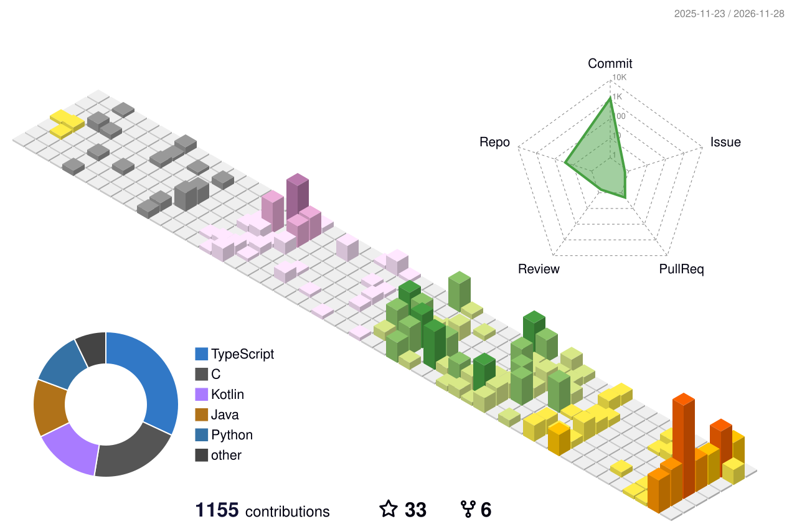

  
  
  

### 👋 你好，我是山鹊

平时写嵌入式，业余做点 Minecraft 插件。

- 🔌 主要玩 STM32 和树莓派，顺手整理了一个驱动库 [Que-STM32-Arsenal](https://github.com/ShanQuea/Que-STM32-Arsenal)
- 🎮 写 Minecraft 插件，`Que*` 系列，比如地牢副本插件 [QueDP](https://www.minebbs.com/resources/quedp-rpg-x.14080)
- 🤖 最近在学着用 LLM 辅助做硬件开发，欢迎交流

### 🛠️ 技术栈

  
  &nbsp;

### 📈 贡献

<picture>
  <source media="(prefers-color-scheme: dark)" srcset="https://raw.githubusercontent.com/ShanQuea/ShanQuea/output/contrib-3d-dark.svg" />
  
</picture>

<picture>
  <source media="(prefers-color-scheme: dark)" srcset="https://raw.githubusercontent.com/ShanQuea/ShanQuea/output/top-langs-dark.svg" />
  
</picture>

  

<picture>
  <source media="(prefers-color-scheme: dark)" srcset="https://raw.githubusercontent.com/ShanQuea/ShanQuea/output/github-contribution-grid-snake-dark.svg" />
  
</picture>

